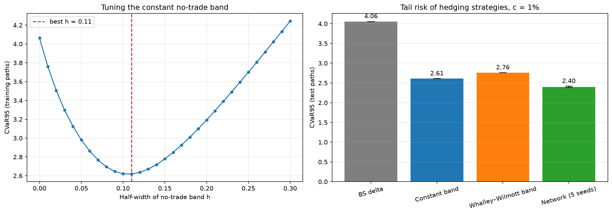
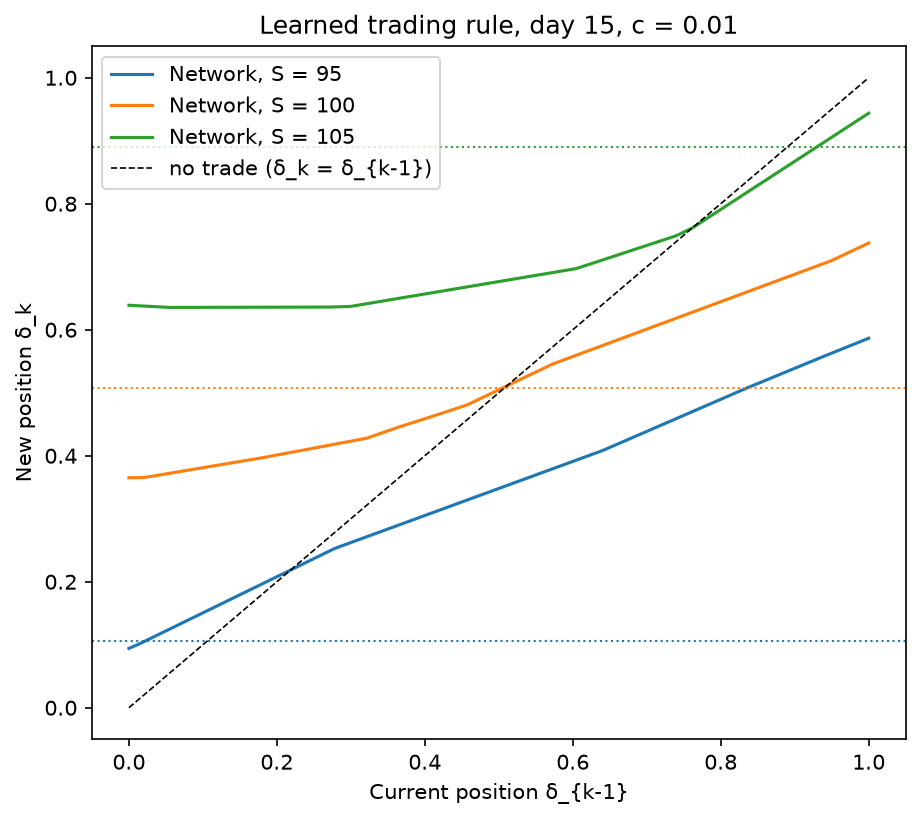
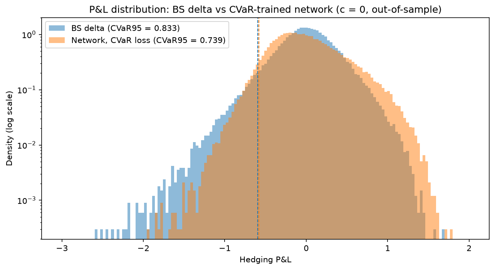
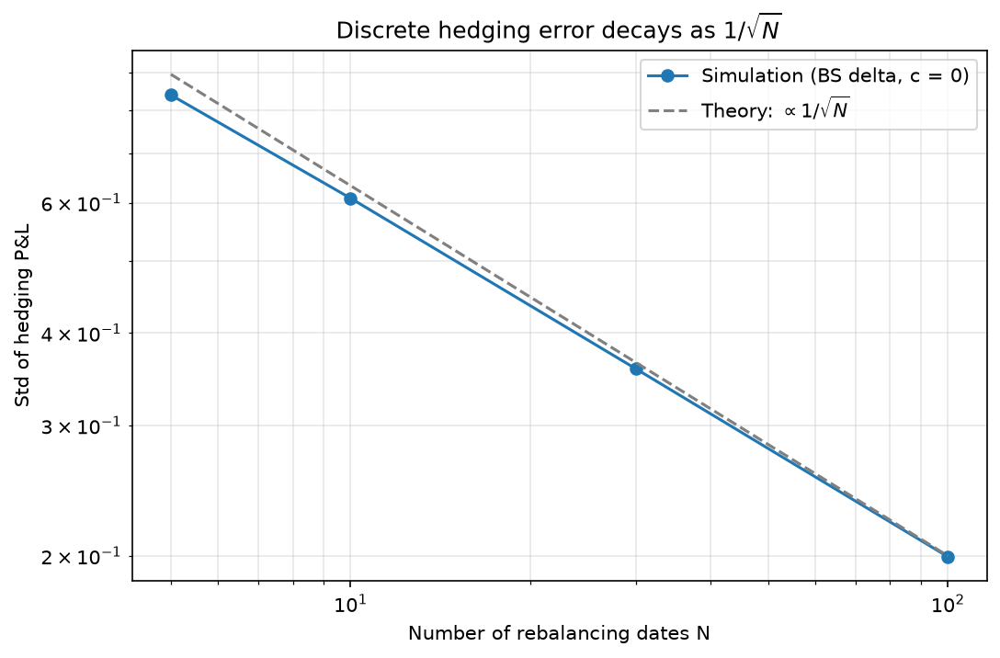
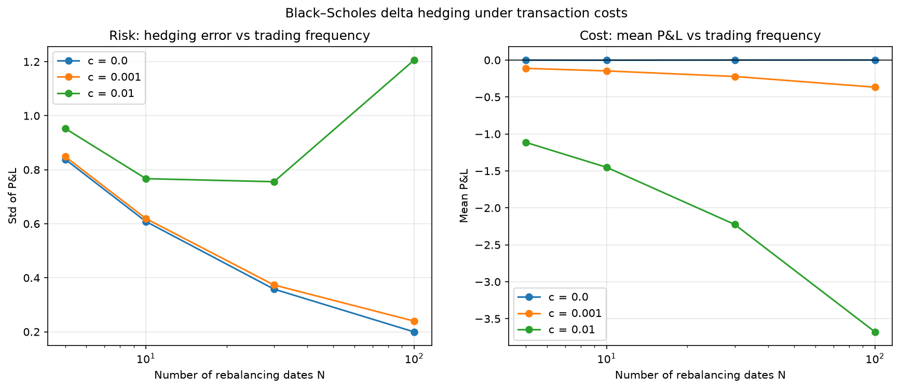

# Deep Hedging under Transaction Costs

Neural-network hedging of a short European call, trained to minimise tail risk (CVaR),
benchmarked against Black–Scholes delta hedging and two classical no-trade-band strategies.
Based on Buehler, Gonon, Teichmann & Wood (2019), *Deep Hedging*.

## Setup
- Underlying: geometric Brownian motion, S0 = K = 100, σ = 20%, μ = r = 0
- Instrument: 30-day at-the-money European call, sold at the Black–Scholes price
- Hedging: daily rebalancing in the underlying (N = 30), proportional transaction costs c
- Network: MLP 3 → 32 → 32 → 1; inputs: normalised log-moneyness, time to maturity,
  current position; rolled out day by day (recurrent), trained only on simulated paths
- Objective: CVaR95 of P&L via the Rockafellar–Uryasev formulation
- Evaluation: out-of-sample on 100,000 fresh paths; network results over 5 training seeds

## Key results

**With 1% transaction costs (out-of-sample):**

| Strategy | Mean P&L | Std | CVaR95 | Turnover |
|---|---|---|---|---|
| No hedge | −0.02 | 3.47 | 10.06 | 0.00 |
| Black–Scholes delta | −2.22 | 0.75 | 4.06 | 2.22 |
| Constant no-trade band (h = 0.11, tuned on train) | −1.04 | 0.71 | 2.61 | 1.03 |
| Whalley–Wilmott band (κ = 0.7, tuned on train) | −1.04 | 0.78 | 2.76 | 1.03 |
| **Deep hedging network (5 seeds)** | −1.22 ± 0.02 | **0.65 ± 0.01** | **2.40 ± 0.02** | ≈ 1.3 |



- Most of the gain over naive BS delta comes from the no-trade principle itself:
  a constant band with one tuned parameter already cuts CVaR95 by 36%.
- The network beats the best classical benchmark by a further 8% in CVaR95
  (gap ≈ 12× the seed-to-seed std) and 9% in P&L std, at the cost of a slightly
  larger mean loss: it trades a bit more to cut the tail, as its objective requires.
- The asymptotic Whalley–Wilmott band, derived for small costs and utility maximisation,
  underperforms a constant band under a CVaR objective with 1% costs: it widens near expiry,
  exactly where tail risk is decided.
- For the same CVaR95, the network-hedged option can be quoted ~26% cheaper
  than with BS delta hedging (indifference premium 4.70 vs 6.35).

**What the network learned:** partial rebalancing towards the target position
and a no-trade region, instead of jumping to the BS delta every day.



**Sanity checks without costs:**
- The network recovers the Black–Scholes delta (mean position error 0.009,
  P&L std 0.369 vs 0.358 for BS delta).
- Trained on CVaR95 instead of mean squared P&L, the network cuts CVaR95 by 11%
  vs BS delta (0.74 vs 0.83) at a higher std: BS delta is variance-optimal, not tail-optimal.



## Why transaction costs matter
Without costs, discrete hedging error decays as 1/√N with the number of rebalancing dates.
With proportional costs, trading costs grow as √N, so rebalancing more often stops helping:
at c = 1% and N = 100 the mean loss of BS delta hedging exceeds the option premium.




## Why a neural network
The hedging problem has no labels: the optimal position on a given day is unknown,
and the loss is defined on the whole trading trajectory, where each decision feeds into
the next state. The policy is therefore trained end-to-end by backpropagating the risk
measure through the simulator. This requires a differentiable policy, which rules out
tree ensembles, and it optimises exactly the chosen risk criterion under exactly the
chosen frictions, which classical rules derived under other assumptions do not.

## Validation of the building blocks
- GBM simulator: E[S_T] and Var(log S_T) match theory within Monte Carlo error
- Black–Scholes price matches Monte Carlo; delta matches finite differences
- Discrete hedging error decays as 1/√N; trading costs grow as √N
- Torch and NumPy P&L implementations agree to float32 precision


## Limitations
- Training and testing on GBM: no fat tails, no volatility clustering
- Option premium from the frictionless BS formula, not from market quotes
- No cost for unwinding the hedge at maturity (delta is close to 0 or 1 there)
- Single option, single maturity, hedging in the underlying only

## Next steps
- Train on block-bootstrapped historical S&P 500 returns, test on 2018–2026
- Stress windows: 2008, March 2020, 2022, April 2025
- Neural VaR/ES model for the hedged book with a Kupiec backtest,
  compared to historical simulation, linear quantile regression and gradient boosting

## Repository
- `src/simulation.py` — GBM simulator
- `src/black_scholes.py` — price, delta, gamma
- `src/hedging.py` — P&L engine, BS delta, constant and Whalley–Wilmott bands, network rollout
- `notebooks/01–06` — one notebook per stage
- `models/` — trained network weights

## Run
```bash
pip install -r requirements.txt
```
